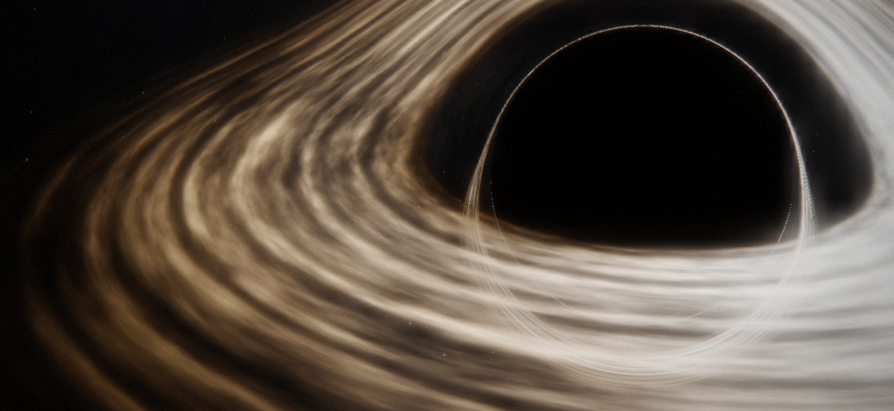
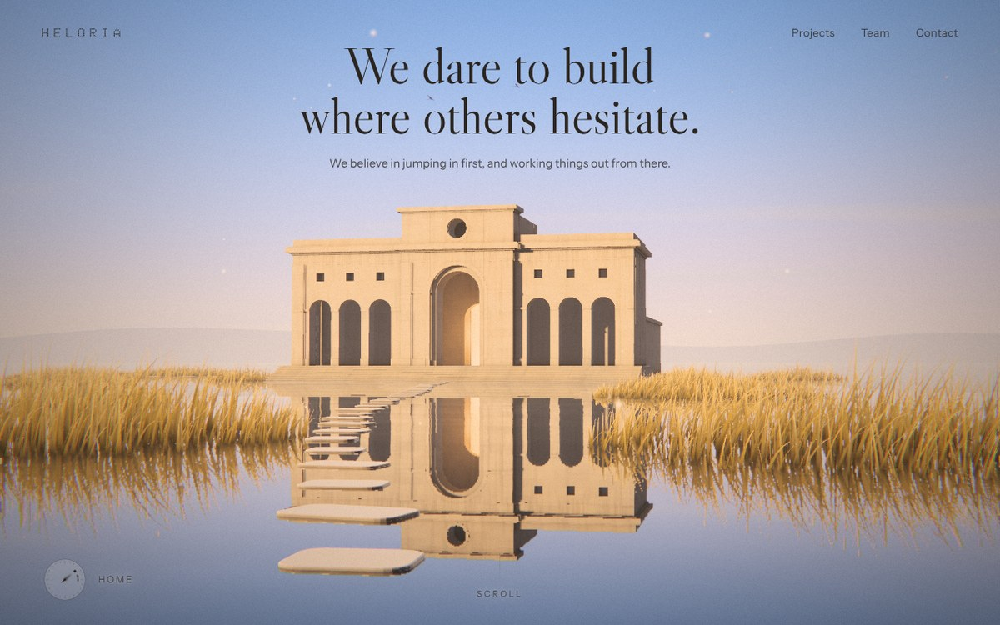
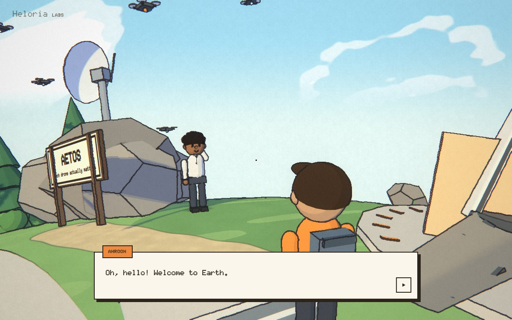
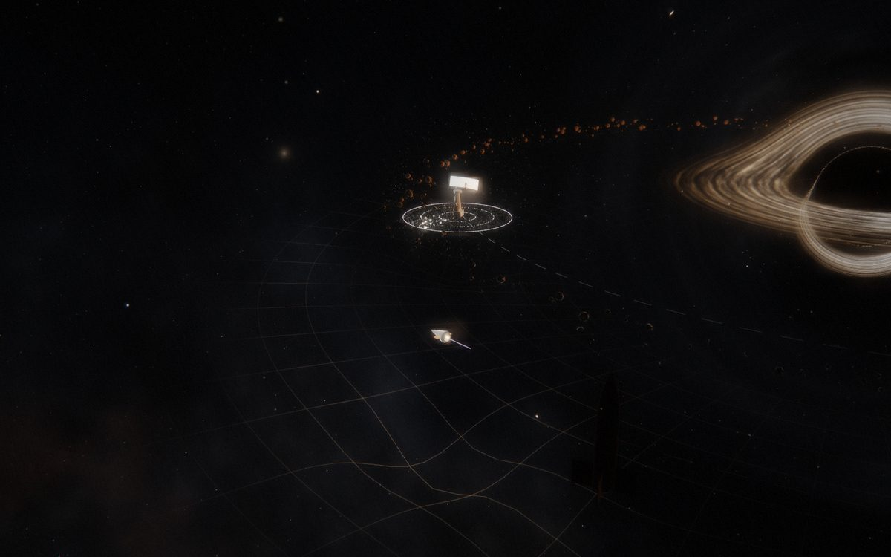

<p align="center"></p>

<h1 align="center">Heloria</h1>

<p align="center">The website I built for Heloria Labs.</p>

<br>

Most company websites are a list of stats. I wanted ours to be somewhere you could actually go.

Heloria Labs is three of us: me, Michael Sweeney Heffernan and Abraham Sabu Kurian. We build around hard problems: 
[Kríos](https://krios.ie) (voice practice for sales teams),
[Aetos](https://github.com/ahroonsanthosh/Aetos) (counter-drone command),
[Pharos](https://github.com/ahroonsanthosh/pharos) (drone navigation without GPS) and
[Ogive](https://github.com/michaelsheffernan/ogive) (AI tools for rocket design).

The site has three ways in.

<table>
<tr>
<td width="33%"></td>
<td width="33%"></td>
<td width="33%"></td>
</tr>
<tr>
<td valign="top"><b>Walk.</b> A pavilion in still water at golden hour, with a room of light for each project. Two minutes.</td>
<td valign="top"><b>Land.</b> Straight down to a little drawn town, where the three of us are waiting to talk. Four minutes.</td>
<td valign="top"><b>Fly.</b> The whole thing: a black hole, a game for every project, and Earth on the other side. Ten minutes.</td>
</tr>
</table>

## How it works

- The black hole is ray-traced through Schwarzschild spacetime in a fragment shader, with a thin disk, Doppler
  beaming and gravitational redshift. Every colour in it comes from one blackbody scale.
- Every sound is made live in the browser with the Web Audio API. There isn't a single audio file in here.
- Earth is a small toon-shaded planet with real pathfinding: click any of us and you walk over, round the fences and
  the trees, and we pick up the conversation where you left it.
- No framework. Plain JavaScript and three.js, built by a short Python script into a static site under 2 MB.

## Running it

```bash
python3 tools/build.py
```

```bash
python3 -m http.server --directory docs 8000
```

It's a static site, hosted on Cloudflare Pages. `wrangler.toml` points Pages at `docs/`, so there's no build step there.

<details>
<summary>Tests</summary>
<br>

Everything is checked in a headless browser with Playwright. The black hole is software-rendered there, so the tests
are slow and best run one at a time.

```bash
node tamed/test/run.cjs --html dist/tamed.html --lowq --scenario tamed/test/flow.cjs
```

```bash
node untamed/test/shot.cjs --html dist/untamed.html --scenario untamed/test/buttons.cjs
```

```bash
node untamed/test/shot.cjs --html dist/untamed.html --station cr --settle 2500 --scenario untamed/test/earth.cjs
```

```bash
node tools/site-smoke.cjs docs
```

Add `--mobile` to any of them for a phone. `tamed/test/sound.cjs` and `untamed/test/sound.cjs` (with `--meter`)
listen to every stage and report how loud it is.
</details>

<br>

<sub>Copyright 2026 Ahroon Santhosh. All rights reserved. See [LICENSE](LICENSE).</sub>
