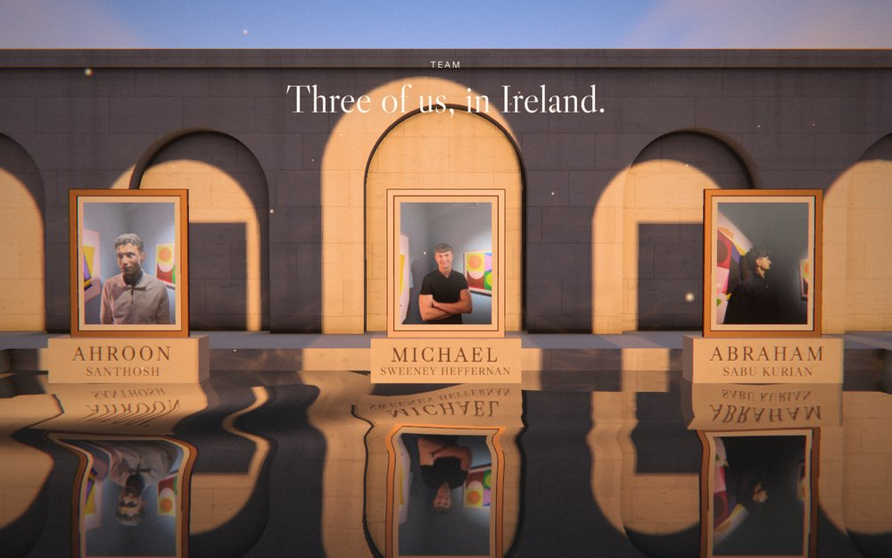
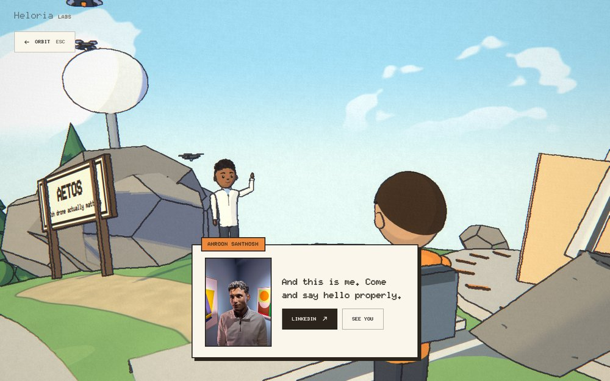

<p align="center"></p>

<h1 align="center">Heloria</h1>

<p align="center">The website I built for Heloria Labs.</p>

<br>

Most company websites are a list of stats. I wanted ours to be somewhere you could actually go.

Heloria Labs is three of us: me, Michael Sweeney Heffernan and Abraham Sabu Kurian. We build around hard problems:
[Aetos](https://github.com/ahroonsanthosh/Aetos) (counter-drone command),
[Pharos](https://github.com/ahroonsanthosh/pharos) (drone navigation without GPS),
[Ogive](https://github.com/michaelsheffernan/ogive) (AI tools for rocket design) and
[Kríos](https://krios.ie) (voice practice for sales teams).

The site has three ways in. Point at one on the front door and you see where it goes before you choose it.

<table>
<tr>
<td width="33%"></td>
<td width="33%"></td>
<td width="33%"></td>
</tr>
<tr>
<td valign="top"><b>Walk.</b> A pavilion in still water at golden hour, with a room of light for each project. Two minutes.</td>
<td valign="top"><b>Land.</b> Straight down to a little drawn town, where the three of us are waiting to talk. Four minutes.</td>
<td valign="top"><b>Fly.</b> The whole thing: a black hole, a game for every project, and Earth on the other side. Ten minutes.</td>
</tr>
</table>

Every way in leads to the three of us. On the walk we stand in frames on plinths in the water; on Earth each
conversation finishes with a photo and a link, and a board outside the café books a chat with us.

<table>
<tr>
<td width="50%"></td>
<td width="50%"></td>
</tr>
</table>

## How it works

- The black hole is ray-traced through Schwarzschild spacetime in a fragment shader, with a thin disk, Doppler
  beaming and gravitational redshift. Every colour in it comes from one blackbody scale.
- Every sound is made in the browser with the Web Audio API, and not one audio file ships with the site. The long
  layers (the music, the water, the engine, each room's and station's air) are rendered once at load with an
  OfflineAudioContext into recordings that play through audio elements, so they hold up while the graphics card is
  busy. A browser pauses for a moment each time it loops a file, so two players take turns on every recording and
  overlap across the seam. Leave the page and the sound stops; come back and it picks up again.
- Earth is a small toon-shaded planet with real pathfinding: click any of us and you walk over, round the fences and
  the trees, and we pick up the conversation where you left it.
- Each project in the walk has its own room built around what it does, from a drone that finds itself on a map in the
  dark to a sales call that rises over a table as lines of light.
- No framework. Plain JavaScript and three.js, built by a short Python script into a static site of about 2 MB.

## Running it

```bash
python3 tools/build.py
```

```bash
python3 -m http.server --directory docs 8000
```

It's a static site on Cloudflare. Every push to `main` deploys `docs/` as it is; `wrangler.toml` points Cloudflare at it.

<details>
<summary>Tests</summary>
<br>

Everything is checked in a headless browser with Playwright. The black hole is software-rendered there, so the tests
are slow and best run one at a time.

```bash
node tamed/test/run.cjs --html dist/tamed.html --lowq --scenario tamed/test/flow.cjs
```

```bash
node untamed/test/shot.cjs --html dist/untamed.html --scenario untamed/test/buttons.cjs
```

```bash
node untamed/test/shot.cjs --html dist/untamed.html --station cr --settle 2500 --scenario untamed/test/earth.cjs
```

```bash
node tools/site-smoke.cjs docs
```

Add `--mobile` to any of them for a phone. `tamed/test/sound.cjs` and `untamed/test/sound.cjs` (with `--meter`)
listen to every stage and report how loud it is, and `untamed/test/leave.cjs` checks the sound stops when you leave the
page. Each game has its own full check: `aetos.cjs`, `krios.cjs`, `ogive.cjs` and `pharos.cjs` in `untamed/test`.
</details>

<br>

<sub>Copyright 2026 Ahroon Santhosh. All rights reserved. See [LICENSE](LICENSE).</sub>
